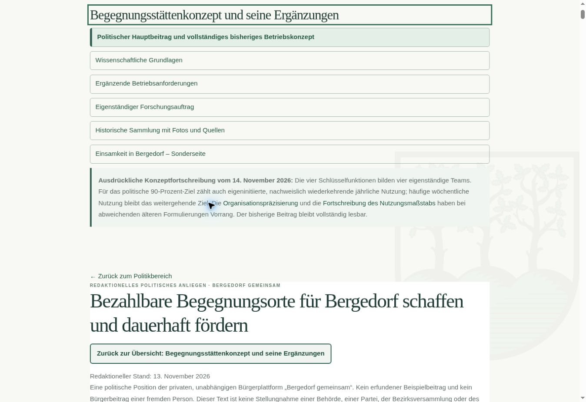
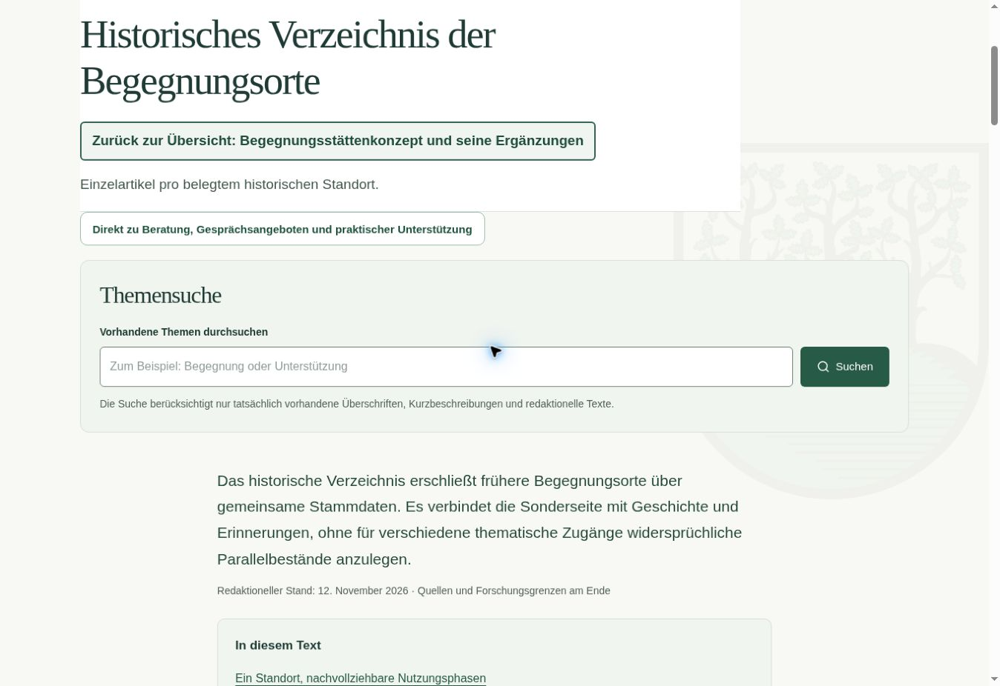

# Abschlussbericht: sechs Navigationswege zum Begegnungsstättenkonzept

Prüfdatum: 15. November 2026. Öffentliche GitHub-Pages-Testfassung: https://markbergedorf.github.io/bergedorf-gemeinsam/

## Veröffentlichungsstand

Die Navigationskorrektur ist veröffentlicht und im Browser auf der öffentlichen Website geprüft. Ausgangsstand war `16bf56fccfd71e92884d15e88fa15324bd6d9f76`; unmittelbar vor der Veröffentlichung lag `main` weiterhin auf diesem Stand. Die Aktualisierung erfolgte mit Prüfung der erwarteten bisherigen Branch-ID, ohne erzwungenes Überschreiben.

**Veröffentlichter Codecommit:** `15ecb6288a629d9e9287130f55b85d2c8d68ff2b`.

**Produktionsbaum:** `98aef3f62307e42ed99d25323d9ce2e8e31c3701`. Der über GitHub übertragene Baum entspricht exakt dem lokal gebauten und geprüften Baum.

**GitHub-Pages-Lauf:** [43755846356](https://github.com/MarkBergedorf/bergedorf-gemeinsam/actions/runs/43755846356), abgeschlossen mit `success`, einschließlich Build und Deployment. Der Produktionsbuild der Anwendung wurde vorher lokal ausgeführt; der bestehende Pages-Workflow veröffentlicht dessen synchronisierte statische Ausgabe.

Dieser Abschlussbericht und seine Prüfbilder werden anschließend als reine Dokumentation ergänzt. Die endgültige Dokumentations-Commit-ID ergibt sich aus der GitHub-Dateihistorie und wird im Abschluss an den Auftraggeber angegeben. Dieser zusätzliche Commit verändert keinen Anwendungscode und keine erzeugten Website-Dateien.

## Tatsächlich festgestellte Fehlerursache

1. `navigate()` beendete einen Aufruf derselben Hash-Adresse unmittelbar. Der erste Link verwies auf die bereits geöffnete politische Hauptseite. Dadurch wurde weder der Hauptbeitrag angesprungen noch sein Fokus gesetzt.
2. Bei einem Routenwechsel scrollte die gemeinsame Navigation synchron nach oben, noch bevor React die neue Ansicht fertig gerendert hatte. Ein Sprung zum tatsächlichen Inhaltstitel fehlte. Die Ergänzungsseiten beginnen mit der gemeinsamen Linkübersicht; bloßes Scrollen an den Dokumentanfang machte ihren eigenen Inhaltstitel deshalb nicht unmittelbar sichtbar.
3. Die Ergänzungen besaßen nur für `abschnitt` einen eigenen Scroll-Effekt. Ein einheitlicher Ablauf für Ansichtstitel, Fokus, wiederholte Auswahl und Verlauf fehlte.
4. Auf der historischen Sammlung und der Einsamkeitsübersicht fehlte der ausdrücklich bezeichnete Rückweg zur Begegnungsstättenübersicht. Der vorhandene historische Zurück-Link führte korrekt zum bisherigen übergeordneten Einsamkeitsthema; er erfüllte einen anderen Zweck.

Vor der Änderung im Livebrowser reproduziert: Der erste Link ließ die sichtbare Position unverändert bei `scrollY=0`; die Hauptüberschrift lag rund 897 CSS-Pixel unterhalb des oberen Randes. Nach dem Wissenschaftslink wechselten Adresse und Inhalt, seine Überschrift lag aber rund 873 CSS-Pixel unterhalb des oberen Randes. Der Fokus befand sich auf dem Link beziehungsweise dem Seitenkörper.

## Umsetzung und Funktionsweise

Die sechs bestehenden Zieladressen bleiben unverändert. Eine auf genau diese Ansichten begrenzte Steuerung ermittelt nach dem React-Rendern das Ziel. Nach zwei Animationsframes erhält die passende Überschrift `tabIndex=-1`, wird ohne vorzeitiges Scrollen fokussiert und anschließend sichtbar an den oberen Rand mit ungefähr einem Rem Abstand gescrollt. Abschnittslinks der Ergänzungen bleiben erhalten und springen zum bezeichneten Abschnitt. Überholte Effekte werden bei einem neuen Routenwechsel abgebrochen.

Für diese sechs Ansichten konkurriert die allgemeine Wiederherstellung gespeicherter Scrollpositionen nicht mehr mit dem gezielten Sprung. Andere Routen behalten ihre bisherige Scrollbehandlung. Wiederholte Aufrufe derselben betroffenen Adresse lösen die Ansichtsbenachrichtigung erneut aus, ohne einen künstlichen zusätzlichen Verlaufseintrag anzulegen. Reguläre Routenwechsel behalten die vorhandenen Push-/Popstate-Wege bei.

Der zusätzliche, als Schaltfläche gestaltete Link trägt überall exakt die Beschriftung:

**„Zurück zur Übersicht: Begegnungsstättenkonzept und seine Ergänzungen“**

Sein Ziel ist `#politik/begegnungsorte?abschnitt=uebersicht`. Der Parameter bezeichnet ausschließlich einen öffentlichen Inhaltsabschnitt. Dort wird die Überschrift der tatsächlichen Übersicht fokussiert und sichtbar gemacht. Auf der politischen Hauptseite und den drei Ergänzungsseiten ist der Rückweg sowohl beim Inhaltstitel als auch am Seitenende vorhanden. Auf der historischen Sammlung und der Einsamkeitsübersicht steht er zusätzlich beim Titel.

Die kontextabhängige Anzeige wurde geprüft. Um auch direkte Aufrufe, Neuladen und geteilte Links zuverlässig abzudecken, wird der klar bezeichnete zusätzliche Rückweg auf den betreffenden Zielansichten immer angeboten. Es werden kein Einstiegsverlauf, keine personenbezogenen URL-Parameter und keine neue Besucherspeicherung benötigt. Fachliche Einordnung, Breadcrumbs und bisherige Zurück-Links bleiben erhalten. Der historische Themenrückweg zu `#einsamkeit/stadtteile` wurde zusätzlich tatsächlich betätigt und mit korrekter Zielüberschrift geprüft.

Die sechs Übersichtslinks sind als abgegrenzte Navigationselemente dargestellt. Der ausgewählte Link ist durch Hintergrund, Schriftstärke und Rand kenntlich. Links und Rückweg besitzen mindestens 44 CSS-Pixel hohe Bedienflächen sowie sichtbare Tastaturfokusmarkierungen. Der bereits vorhandene mobile Sichtbarkeitsfix für die Inhaltsnavigation bleibt unverändert erhalten.

## Geänderte Dateien

Anwendung:

- `frontend/app/encounter-navigation.tsx` – neue Rückkehrkomponente und Steuerung nach dem Rendern.
- `frontend/lib/encounter-navigation.mjs` – begrenzte Zuordnung von Routen zu Inhaltszielen und fester Übersichtsanker.
- `frontend/app/navigation.tsx` – erneute Benachrichtigung bei identischen betroffenen Adressen; keine konkurrierende Scrollwiederherstellung dort.
- `frontend/app/platform.tsx` – Einbindung der gezielten Fokussteuerung.
- `frontend/app/encounter-policy.tsx` – Titelanker und zwei zusätzliche Rückkehrlinks.
- `frontend/app/encounter-supplements.tsx` – Übersichts-/Titelanker, zusätzliche Rückkehrlinks; Abschnittssprünge in die gemeinsame gezielte Steuerung übernommen.
- `frontend/app/loneliness.tsx` – zusätzlicher Rückweg auf Einsamkeitsübersicht und historischer Sammlung.
- `frontend/app/encounter-supplements.css` – erkennbare Navigationselemente, Rückkehrgestaltung, Fokus und Umbruch.

Tests:

- `frontend/tests/encounter-navigation.test.mjs` – neue Regressionen für alle sechs Wege, späteres Rendern, Fokus, Scrollen, wiederholte Ausführung, Abbruch überholter Sprünge und Begrenzung auf die vorgesehenen Routen.
- `frontend/tests/encounter-policy.test.mjs` und `frontend/tests/encounter-supplements.test.mjs` – bestehende Inhaltsvergleiche um die exakt beauftragten Navigationsergänzungen bereinigt.
- `frontend/tests/fixtures/encounter-navigation-authorized-changes.json` und `frontend/tests/fixtures/encounter-supplement-navigation.mjs` – genaue, rückführbare Navigationsergänzungen; die übrigen Bytes bleiben weiterhin geschützt.

Regulär neu erzeugt beziehungsweise synchronisiert: `index.html`, `404.html` und die vom Build benannten JavaScript-/CSS-Dateien in `assets/`. Alte, ersetzte Hash-Dateien wurden durch die reguläre Synchronisierung entfernt. Datenbestände und Bilddateien wurden nicht geändert. Hinzu kommen dieser Bericht und drei Prüfbilder unter `docs/navigation/`.

## Vollständige Live-Funktionsmatrix

Jede Tabellenzelle umfasst: Übersicht öffnen, Ziel auswählen, tatsächliche Adresse und richtige sichtbare Zielüberschrift mit Fokus prüfen, neuen Rückweg betätigen, sichtbare Übersicht prüfen, einen anderen Link auswählen und Browser-Zurück/-Vorwärts durch Ziel, Übersicht und anderes Ziel prüfen. Der Ablauf wurde mit Mausklick und anschließend mit Enter-Bedienung wiederholt.

| Zieladresse | Desktop Maus | Desktop Tastatur | Schmal Maus | Schmal Tastatur |
|---|---|---|---|---|
| `#politik/begegnungsorte` | bestanden | bestanden | bestanden | bestanden |
| `#politik/begegnungsorte/wissenschaft` | bestanden | bestanden | bestanden | bestanden |
| `#politik/begegnungsorte/betrieb` | bestanden | bestanden | bestanden | bestanden |
| `#politik/begegnungsorte/forschung` | bestanden | bestanden | bestanden | bestanden |
| `#einsamkeit/stadtteile/t10-6` | bestanden | bestanden | bestanden | bestanden |
| `#einsamkeit` | bestanden | bestanden | bestanden | bestanden |

Gemessene Breiten im Chromium-Browser:

- Desktop: `innerWidth=1363`, nutzbare Dokumentbreite und Scrollbreite jeweils `1348` CSS-Pixel.
- Schmale Ansicht: `innerWidth=340`, nutzbare Dokumentbreite und Scrollbreite jeweils `337` CSS-Pixel. Diese Breite wurde mit 400 Prozent Browserzoom hergestellt; die sichtbare Höhe betrug 234 CSS-Pixel. Dies ist ein responsiver Browser-/Zoomtest, kein Test auf einem physischen Smartphone.
- Zielüberschriften und Übersicht nach abgeschlossenem Sprung: ungefähr 15,6 bis 16,4 CSS-Pixel vom oberen Rand entfernt. Der Fokus lag jeweils auf der richtigen Überschrift. Kein horizontaler Dokumentüberlauf in den geprüften Ansichten.

Zusätzlich auf beiden Breiten bestanden:

- Alle sechs Zieladressen direkt aufgerufen und neu geladen; anschließend Rückkehr zur Übersicht.
- Die ersten vier Links erneut bei bereits geöffnetem gleichnamigem Ziel angeklickt; der Titel wurde wieder sichtbar und fokussiert.
- Rückkehrlinks am Seitenende des Hauptbeitrags und aller drei Ergänzungen tatsächlich angeklickt.
- Echte Tab-Reihenfolge: Übersichtstitel → erster Link → Wissenschaftslink; nach Enter auf der Wissenschaftsseite Titel → Rückkehrlink. Fokusrahmen sichtbar (`outline-style: solid`).

Mobiles Hauptmenü zusätzlich geöffnet und geschlossen; `aria-expanded` wechselte korrekt zwischen `true` und `false`. Die Inhaltsnavigation blieb sichtbar. Bestehender historischer Themenrückweg funktionierte unabhängig vom neuen Rückweg.

## Automatisierte Prüfung, Produktionsbuild und Bestandsschutz

- `npm test`: **245 Tests, 245 bestanden, 0 fehlgeschlagen, 0 übersprungen**.
- `npm run build`: erfolgreich. Die Ausgabekontrolle bestätigte **263 Dateien**, Basis `/bergedorf-gemeinsam/`, `noindex` und `liveRecords=0`.
- `node scripts/sync-pages.mjs`: Ausgabe am Repository-Stamm vollständig mit `frontend/dist` abgeglichen.
- `git diff --check`: ohne Fehler.
- Nach der Übertragung: Anwendung, Tests, Assets und beide HTML-Dateien stimmen zwischen lokal geprüftem Baum und `origin/main` überein.
- Bereits bekannte Buildhinweise zu großen JavaScript-Chunks und Leaflet-CSS bestehen weiter; sie führten zu keinem Buildabbruch.

Der gesamte politische Artikel ist bis auf die notwendigen Navigationsanker und zusätzlichen Rückkehrkomponenten bytegleich erhalten. Die bestehenden Vergleiche kontrollieren nach präziser Rücknahme ausschließlich dieser autorisierten Ergänzungen weiterhin den ursprünglichen Inhalt. Sämtliche bestehenden redaktionellen JSON-Dateien einschließlich Wissenschaft, Betriebskonzept, Forschungsauftrag, aller 139 Einsamkeitsansichten, historischen Datensätze, Bildzuordnungen und Quellen wurden unverändert erhalten. Die Hauptnavigation wurde nicht geändert.

Keine Registrierung, Speicherung von Kommentaren, Umfrage oder sonstige öffentliche Datenerfassung wurde aktiviert. Die neuen Komponenten enthalten keine Datenübermittlung oder neue Persistenz. Die vorhandenen Testfunktionen und die deaktivierte Unterstützerregistrierung bleiben in ihrem bisherigen Zustand.

## Grenzen und offene Punkte

Für die sechs beauftragten Hin- und Rückwege blieb nach den abschließenden Liveprüfungen kein bekannter Fehler offen. Die Prüfung erfasst Chromium in den genannten Breiten, einschließlich Tastatur, Browser-Verlauf, direkten Aufrufen und Neuladen. Physische Smartphones, andere Browser und ein eigenständiger Screenreader-Lauf wurden nicht geprüft; der Fokus wurde im DOM und über die reale Tastaturbedienung kontrolliert.

Die bisherigen offenen Quellenidentitäten und ausstehenden wissenschaftlichen Volltext-/Wirkungsnachweise bleiben ausdrücklich gekennzeichnet. Wissenschaftliche oder historische Aussagen wurden für diese Navigationskorrektur nicht verändert. Eine uneingeschränkte wissenschaftliche Vollabnahme ist mit diesem technischen Abschluss nicht verbunden.

## Prüfbilder

