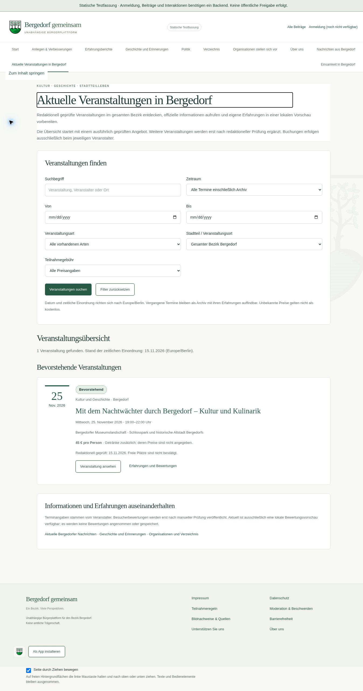
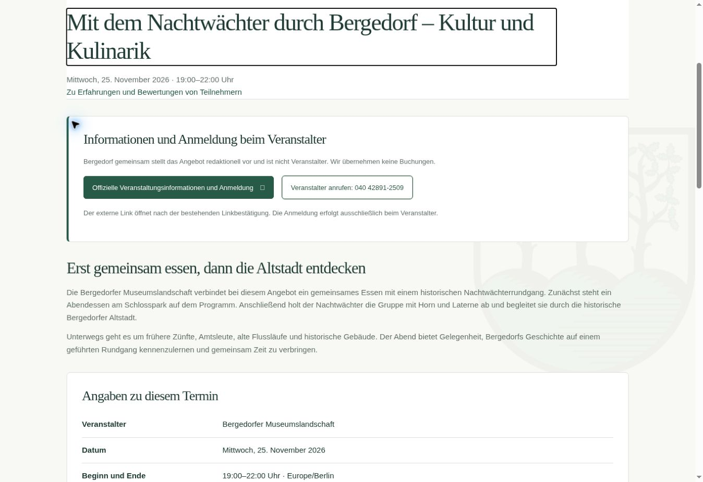

# Arbeitsauftrag 11: Aktuelle Veranstaltungen in Bergedorf

Prüf- und Umsetzungsstand: 15. November 2026. Dieser Auftrag ergänzt die vorhandene Website; die Nummerierung der Aufträge 1 bis 10 bleibt erhalten. Es wurde keine neue sichtbare Website-Versionsnummer eingeführt.

## Veröffentlichung und Adressen

- Veranstaltungsübersicht: https://markbergedorf.github.io/bergedorf-gemeinsam/#veranstaltungen
- Nachtwächterrundgang: https://markbergedorf.github.io/bergedorf-gemeinsam/#veranstaltungen/nachtwaechter-kultur-kulinarik/2026-11-25
- Besucherbewertungen und lokale Vorschau: https://markbergedorf.github.io/bergedorf-gemeinsam/#veranstaltungen/nachtwaechter-kultur-kulinarik/2026-11-25?abschnitt=bewertungen

Ausgangsstand von `main`: `682184d4e752423468b88cbb93ff3c8e237b5245`. Er wurde vor der Übertragung erneut überprüft. Die Aktualisierung des Hauptbranches erfolgt mit erwarteter vorheriger Commit-ID und ohne erzwungenes Überschreiben.

Veröffentlichter Anwendungscode: **7ad6d7c22a6836c7b5bfd1e015ebc9d28894b812**.

Produktionsbaum: `fb9bb0933b515dcf185fa0cf5a29939251d1ba99`.

GitHub-Pages-Lauf: **[43764379378](https://github.com/MarkBergedorf/bergedorf-gemeinsam/actions/runs/43764379378), abgeschlossen mit `success` (Build und Deployment).**.

Liveprüfung: **Erfolgreich auf der tatsächlich veröffentlichten GitHub-Pages-Website, einschließlich erneuter Livekontrolle nach der Lesbarkeitskorrektur.**.

Der abschließende Dokumentationscommit ergänzt ausschließlich diesen Bericht und Prüfbilder. Seine endgültige Commit-ID ist über die GitHub-Dateihistorie nachvollziehbar und wird im Abschluss an den Auftraggeber angegeben.

## Umgesetzte Funktionen

Eine eigenständige Hauptseite „Aktuelle Veranstaltungen in Bergedorf“ ist über einen zusätzlichen Hauptmenüpunkt erreichbar. Sie ist keine Unterrubrik von Nachrichten oder Einsamkeit. Die bestehenden Menüpunkte wurden vollständig erhalten; das mobile Menü verwendet weiterhin die bestehende Öffnen-/Schließen-Steuerung.

Die Übersicht bietet Veranstaltungskarten mit Datum, Uhrzeit, Veranstalter, Veranstaltungsgebiet, Preis, zusätzlichen Kosten, zeitlichem Status und redaktionellem Prüfdatum. Jede Karte verlinkt zur eigenen Detailseite und zum zugehörigen Bewertungsabschnitt. Aktuell ist ausschließlich der beauftragte, anhand des offiziellen Programms geprüfte Rundgang enthalten.

Suche und kombinierbare Filter berücksichtigen:

- Suchbegriff im Titel, Veranstalter, Gebiet, Stadtteil und Veranstaltungsart.
- Alle Termine, bevorstehende, heute stattfindende oder vergangene Veranstaltungen.
- Zeitraum von/bis einschließlich der gewählten Kalendertage.
- Tatsächlich vorhandene Veranstaltungsarten und Stadtteile.
- Kostenlose und kostenpflichtige Angebote; unbekannte Preise werden nicht als kostenlos behandelt.

Filter werden als interne Query-Parameter abgebildet und sind damit direkt aufrufbar. Widersprüchliche Datumsgrenzen erzeugen eine verständliche Fehlermeldung. Leere Ergebnisse werden ausdrücklich angezeigt; ein Zurücksetzen ist möglich. Es findet keine automatische Übernahme fremder Kalender statt.

## Datenstruktur und zeitliche Einordnung

`frontend/lib/events.json` trennt Veranstaltungsreihen (`series`) und einzelne Termine (`occurrences`). Die Reihe besitzt eine dauerhafte eigene Kennung. Jeder Termin hat zusätzlich seine eigene Kennung, eindeutige Datumsadresse, Beginn/Ende mit Zeitzonenoffset, Preis und Teilnahmebedingungen sowie Quellen und Prüfdatum. Weitere Termine dürfen erst mit jeweils erneut geprüften Angaben ergänzt werden. Die vorhandenen Bedingungen werden nicht automatisch auf neue Termine übertragen.

Die Einordnung wird zur tatsächlichen Browserzeit mit der ausdrücklich festgelegten Zeitzone `Europe/Berlin` berechnet. Sommer-/Winterzeit und Berliner Tageswechsel werden berücksichtigt. Ein Termin ist spätestens ab seinem tatsächlichen Ende vergangen, auch wenn derselbe Kalendertag noch läuft. Laufende Termine über Mitternacht werden korrekt berücksichtigt. Ein Timer aktualisiert die zeitliche Einordnung alle 30 Sekunden; zusätzlich erfolgt eine Aktualisierung bei Rückkehr zum Tab beziehungsweise Fenster.

Vergangene Einträge bleiben mit derselben Adresse als Archiv auffindbar. Die Bewertungszuordnung bleibt an die Reihe gebunden und enthält das konkrete Besuchsdatum. Für wesentlich andere Veranstalter, Konzepte oder Strecken ist eine eigene Zuordnung redaktionell zu prüfen.

## Geprüfte Veranstaltungsangaben und Quellen

Verpflichtender erster Eintrag: **Mit dem Nachtwächter durch Bergedorf – Kultur und Kulinarik**. Veranstalter: **Bergedorfer Museumslandschaft**.

| Angabe | Geprüfter Stand für diesen Termin |
|---|---|
| Datum | Mittwoch, 25. November 2026 |
| Beginn / Ende | 19:00–22:00 Uhr, Europe/Berlin |
| Teilnahmegebühr | 45 Euro pro Person |
| Zusätzliche Kosten | Getränke zusätzlich; keine Getränkepreise angegeben |
| Anmeldung | telefonisch beim Veranstalter: 040 42891-2509 |
| Reihenfolge | zuerst gemeinsames Essen am Schlosspark, danach Abholung und geführter Altstadtrundgang mit Horn und Laterne |
| Inhalt | Bergedorfer Geschichte, Zünfte, Amtsleute, Flussläufe und historische Gebäude |
| Genauer Treffpunkt / vollständige Wegstrecke | nicht bestätigt |
| Barrierefreiheit des Rundgangs | nicht bestätigt |
| Altersvoraussetzungen / Anmeldefrist / freie Plätze | nicht angegeben beziehungsweise nicht bestätigt |

Am 15. November 2026 gelesen und geprüft:

1. [Offizielles Veranstaltungsprogramm für den 25. November 2026](https://www.bergedorfer-museumslandschaft.de/programm/2026-11-25/841/mit-dem-nachtwaechter-durch-bergedorf-kultur-und-kulinarik). Der Link war erreichbar und lieferte genau den Veranstaltungstitel, den Termin, die Uhrzeiten, 45 Euro zuzüglich Getränke und die Anmeldenummer. Die Reihenfolge Essen → Rundgang wurde aus dem Originalprogramm übernommen und in eigenen Worten beschrieben.
2. [Offizieller Besucherservice](https://www.bergedorfer-museumslandschaft.de/service). Bestätigt die vollständige Hamburger Telefonnummer mit Vorwahl und ist als Kontaktquelle für Rückfragen verlinkt.
3. [Impressum des Veranstalters](https://www.bergedorfer-museumslandschaft.de/impressum). Bestätigt Veranstalterbezeichnung und Telefonnummer.

Der gut sichtbare Link heißt „Offizielle Veranstaltungsinformationen und Anmeldung“. Er verwendet die bestehende externe Linkbestätigung. Die Website nimmt keine Buchungen entgegen. Der telefonische Link führt ausschließlich zum Veranstalter; ein Anruf wurde bei der Prüfung nicht ausgelöst.

Mangels dokumentierter Nutzungserlaubnis wurden keine Fotos der Veranstalterseite übernommen. Vorhandene historische Bilder und ihre dokumentierten Nutzungsgrundlagen wurden nicht verändert.

## Bewertungsfunktion: tatsächlicher Status

**Ausschließlich bedienbare lokale Vorschau. Keine öffentliche Bewertungsannahme, keine Speicherung, kein Moderationseingang, keine Veröffentlichung von Eingaben.**

Die Prüfung des aktuellen technischen Bestands ergab:

- `frontend/pages/backend-client.mjs`: `apiBase:null`, `publicReadsApproved:false`, `writesEnabled:false`.
- `frontend/app/workspace.tsx`: statischer öffentlicher Lesestand; Schreib- und Uploadaufrufe sind blockiert.
- `frontend/scripts/generate-public-data.mjs`: keine produktiven Dokumente, Kommentare, Reaktionen oder Moderationsdaten im öffentlichen Zustand; öffentliche Teilnahme- und Administrationsrechte deaktiviert.

Es ist kein für öffentliche Veranstaltungsbewertungen angeschlossener und freigegebener Backenddienst konfiguriert. Die bisherigen Kommentar-Testformulare bilden keinen solchen Dienst. Es wurde weder ein externer Dienst beauftragt noch eine vorhandene private Datenablage öffentlich geschaltet. Damit greift die im Auftrag ausdrücklich vorgesehene Umsetzung mit deaktivierter öffentlicher Annahme.

Die Vorschau enthält:

- Auswahl von einem bis fünf Sternen mit den vorgegebenen verbalen Bezeichnungen, einschließlich negativer Einschätzungen.
- Erfahrungsbericht mit mindestens 30 und höchstens 5.000 Zeichen; sichtbarer Unicode-Zeichenzähler.
- Besuchsdatum, das gültig und nach Europe/Berlin nicht zukünftig sein darf.
- Freiwilliger öffentlicher Anzeigename, höchstens 60 Zeichen, mit Zähler; ohne Angabe wird „Anonym“ verwendet.
- Verpflichtende Erklärung zur eigenen Teilnahme mit dem beauftragten Wortlaut und ausdrücklicher Kennzeichnung als Selbstauskunft.
- Verständliche feldbezogene Fehler, Fokus auf das erste fehlerhafte Feld und lokale Ergebnisvorschau.
- Möglichkeit zum Löschen der lokalen Eingaben.

Der Button heißt ausdrücklich „Eingaben lokal prüfen“. Auch bei gültigen Angaben lautet das Ergebnis eindeutig: „Lokal geprüft. Nichts eingereicht, gespeichert oder veröffentlicht.“ Das Ergebnis erscheint getrennt als „Ihre lokale Vorschau – keine veröffentlichte Bewertung“. Ein früheres Besuchsdatum ist keine Bestätigung eines tatsächlich angebotenen oder besuchten früheren Termins; die Reihen- und Terminzuordnung wäre vor einer späteren Veröffentlichung redaktionell zu prüfen.

Die Datenstruktur enthält derzeit **keine veröffentlichten Bewertungen**. Deshalb steht der vorgegebene neutrale Hinweis auf der Seite; ein Durchschnitt und öffentliche Sternebewertungen werden nicht erfunden. Der vorbereitete Anzeigevertrag berücksichtigt ausschließlich ausdrücklich zur Veröffentlichung freigegebene Datensätze genau derselben Reihe. Offene, abgelehnte, fremde oder zukünftig datierte Datensätze fließen nicht in einen Durchschnitt ein. Anzahl und Berechnungsstand sind für eine spätere tatsächliche Anzeige vorgesehen.

## Moderation, Datenschutz und Voraussetzungen zur Freischaltung

Für diese Fassung wurde technisch geprüft: Die Bewertungsvorschau enthält keine Netzwerkschreibaufrufe, keine Serveraktion und keine Speicherung ihrer Eingaben in Local Storage, Session Storage, IndexedDB oder Cookies. Bewertungsinhalte werden auch nicht in URL-Parameter übernommen. Suchfilter werden dagegen ausdrücklich als Hash-Parameter im lokalen Browser-Verlauf abgebildet; die bestehende Navigation kann dazu ihre Scrollposition verwalten. Eingaben bleiben im flüchtigen React-Zustand und werden beim Verlassen/Neuladen verworfen. Es werden weder E-Mail-Adressen noch andere Kontaktdaten für die Vorschau verlangt. HTML-Tags werden durch die lokale Prüfung abgewiesen; ausgegebene Texte werden durch React als Text behandelt, nicht als HTML ausgeführt. Dies ersetzt keine spätere serverseitige Prüfung.

Die Vorschau weist vor Eingaben auf ihren Status hin und fordert dazu auf, keine privaten Daten Dritter, Kontaktdaten oder Gesundheitsdaten einzugeben. Datenschutz-, Teilnahme- und Moderationsregeln sind verlinkt. Der eigene Datenverarbeitungsweg der Vorschau wurde geprüft; eine allgemeine rechtliche Vollabnahme oder Barrierefreiheitszertifizierung wird nicht behauptet. Bereits bestehende betriebliche Verarbeitung beim Hosting ist davon zu unterscheiden.

Vor produktiver Freischaltung fehlen weiterhin konkret:

1. Ein ausdrücklich freigegebener HTTPS-Eingang mit serverseitiger Schema-, Text-, Datums-, Sterne-, Reihen- und Terminprüfung.
2. Eine geschützte Datenbank für unveröffentlichte Einsendungen; keine frei lesbare öffentliche Ablage und keine clientseitigen Geheimnisse.
3. Authentifizierung und rollenbasierter Zugriff auf den nicht öffentlichen Moderationsbereich.
4. Nachvollziehbare Moderationsentscheidungen und eine technisch erzwungene Trennung zwischen eingereicht, geprüft, freigegeben und abgelehnt.
5. Ein nur lesender öffentlicher Ausgabeweg, der ausschließlich freigegebene Daten liefert.
6. Angemessener Schutz gegen automatisierten Spam und missbräuchliche Mehrfacheinsendungen, ohne unnötige personenbezogene Datenerhebung.
7. Geprüfte und dokumentierte Rechtsgrundlage, Verantwortlichkeit, zutreffende Datenschutzinformationen sowie erforderliche Vereinbarungen mit Dienstleistern.
8. Konkrete, beschlossene Aufbewahrungs- und Löschfristen für offene, abgelehnte und veröffentlichte Inhalte einschließlich deren tatsächlicher technischer Durchsetzung und Sicherungskopien.
9. Ein funktionsfähiges, datensparsames Verfahren zur Beanstandung und Entfernung unzulässiger Bewertungen.
10. Redaktionelle Zuständigkeiten, Kriterien und Abläufe; sachliche negative Bewertungen dürfen nicht allein wegen ihrer negativen Einschätzung benachteiligt werden.
11. Sicherheits- und Zugriffstests einschließlich unberechtigter Zugriffe, Fremdzuordnung, Schadcode, Mehrfacheinsendungen und Veröffentlichung ohne Freigabe.
12. Eine gesonderte dokumentierte Freischaltung nach erfolgreicher Prüfung aller Voraussetzungen.

Keine dieser noch offenen Voraussetzungen wird durch die lokale Vorschau als bereits erfüllt ausgegeben. Sie verhindert den technischen Abschluss der ausdrücklich vorgesehenen statischen Variante nicht; die produktive Bewertung bleibt bis dahin deaktiviert.

## Interne Verlinkungen und Bestandsschutz

Übersicht, Detailseite und Bewertungsabschnitt sind untereinander verlinkt und erhalten sinnvolle Titel-/Abschnittsfokussierung nach dem Rendern. Weitere Links führen zu den unverändert vorhandenen Bereichen Geschichte, Nachrichten, Organisationen/Verzeichnis sowie zu den bereits vorhandenen Profilen „Bergedorf Museum im Schloss“ und „Bergedorfer Schlosspark / Schlossgarten“. Diese Profile werden zur Orientierung genannt und nicht als bestätigter Treffpunkt ausgegeben. Ein sachlich begründeter Link führt zum Einsamkeitsthema Begegnung. Eine nachgewiesene Wirkung des Rundgangs gegen Einsamkeit wird ausdrücklich nicht behauptet.

Neue Dateien: `frontend/app/events.tsx`, `frontend/app/events.css`, `frontend/lib/events.json`, `frontend/lib/events.mjs`, `frontend/tests/events.test.mjs` sowie dieser Bericht und seine Prüfbilder.

Am vorhandenen Anwendungscode wurden ausschließlich drei notwendige Ergänzungen in `frontend/app/platform.tsx` vorgenommen: Import, zusätzlicher Hauptmenüpunkt und Route. Die bestehende Bestands-Testhilfe wurde um genau diese rückführbaren Ergänzungen erweitert. Hinzu kommen die regulär neu erzeugten JavaScript-/CSS-Assets und HTML-Einstiegsdateien aus dem Produktionsbuild. Andere bestehende Anwendungsdateien, redaktionelle JSON-Bestände, alle 139 Einsamkeitsansichten, historische Daten und Bilder, Quellenregister, politische Beiträge und Kommentar-Testfunktionen blieben bytegleich erhalten. Die neue Bestandsregression prüft dies gegen den Ausgangscommit.

## Automatisierte Tests und Produktionsbuild

- **263 Tests, 263 bestanden, 0 fehlgeschlagen, 0 übersprungen**. Davon 18 neue Veranstaltungstests zusätzlich zu 245 bisherigen Prüfungen.
- Geprüft werden unter anderem der tatsächliche Veranstaltungsdatensatz, direkte Adressen, Berliner Tageswechsel und Sommer-/Winterzeit, Ende/Archivierung, Termine über Mitternacht, Suche und alle Filterarten, unbekannte Preise, Datumsgrenzen, alle Sternebewertungen, Text- und Namensgrenzen, Unicode, HTML-Abweisung, Selbstauskunft, Fremdzuordnungen und ausschließlich freigegebene Durchschnittswerte.
- `npm run build`: erfolgreich. Ausgabekontrolle: **263 Dateien**, Basis `/bergedorf-gemeinsam/`, `htmlNoindex=true`, vier bestehende Beispiele, 69 redaktionelle Verzeichniseinträge, `liveRecords=0`.
- `node scripts/sync-pages.mjs`: Ausgabe am Repository-Stamm vollständig mit `frontend/dist` abgeglichen.
- `git diff --check`: ohne Fehler.
- Bereits vorhandene Hinweise zu großen JavaScript-Chunks und zur Leaflet-CSS-Auflösung bleiben bestehen; kein Buildabbruch.

## Bei der Liveprüfung korrigierte Darstellung

Eine vorhandene allgemeine Linkregel setzte den Link im Veranstaltungskartentitel zunächst auf 13 Pixel herab, obwohl die Überschrift 27 Pixel vorsah. Die Regel `.events-page .event-card h3 a{font:inherit}` behebt dies ausschließlich im neuen Veranstaltungsbereich. Vor der Korrektur wurden im Livebrowser tatsächlich 13 Pixel am Link und 27 Pixel an der Überschrift gemessen; nach der Korrektur wurde die neue Ausgabe erneut gebaut und geprüft. Die Hauptnavigation und bestehende Karten anderer Bereiche bleiben unverändert.

Die erste Veröffentlichung erfolgte mit `f5d7929ab2492c82d7b839a19bf9bb2e4ab7d39b` im erfolgreichen Pages-Lauf [43763642602](https://github.com/MarkBergedorf/bergedorf-gemeinsam/actions/runs/43763642602). Der oben angegebene Anwendungscode enthält zusätzlich die gezielte Lesbarkeitskorrektur.

## Browserprüfung

Vor Veröffentlichung in der Vorschau geprüft: Übersicht und ausführliche Detailseite; Suchbegriff; kostenpflichtig/kostenlos mit zutreffender Leermeldung; Hauptnavigation; mobile Menübedienung; externer Bestätigungsdialog mit exakter Originaladresse; Bewertungsabschnitt, leere Pflichtfelder, Zukunftsdatum, lokale Ein-Stern-Vorschau, Zeichenzähler, Löschen und leere Eingaben nach Neuladen. Es wurden ausschließlich ausdrücklich bezeichnete technische Testtexte in der lokalen Vorschau verwendet; sie wurden nicht als echte Bewertungen gespeichert oder veröffentlicht.

Nach Veröffentlichung tatsächlich im öffentlichen Browser geprüft:

| Prüfung | Ergebnis |
|---|---|
| Direkter Aufruf und Neuladen der Übersicht | richtige Überschrift, ein geprüfter Eintrag, vorhandene Hauptnavigation plus eigener neuer Menüpunkt |
| Direkter Aufruf und Neuladen der Detailseite | richtiger Rundgang, bestätigte Termin-/Preis-/Anmeldeangaben und ausdrücklich offene Angaben |
| Übersicht → Detail → Bewertungsabschnitt → Übersicht | richtige Adresse, gerenderter Inhalt und sinnvolle Titel-/Abschnittsfokussierung |
| Browser-Zurück und -Vorwärts | Übersicht und Detail werden erneut korrekt angezeigt |
| Preisfilter kostenpflichtig / kostenlos | ein Treffer / keine Treffer mit verständlicher Leermeldung |
| Zeitfilter bevorstehend / heute / vergangen | zum Prüfdatum korrekt ein / null / null Treffer |
| Suche zusammen mit Art, Stadtteil, Preis und Datumsspanne 25.11.–25.11. | ein zutreffender Eintrag, Kombination in der internen Adresse erhalten |
| Widersprüchlicher Zeitraum | verständliche Fehlermeldung; keine Anwendung ungültiger Filter |
| Externer Originalveranstaltungslink | bestehende Linkbestätigung mit exakter Originaladresse; nach Bestätigung tatsächlich richtige Programmseite mit Titel, Termin, Preis und Anmeldung geöffnet |
| Vorhandene interne Ziele | Schlossprofil, Schlossparkprofil, Geschichte, Nachrichten und Einsamkeitsthema Begegnung tatsächlich aufgerufen; richtige Inhalte angezeigt |
| Leere Bewertungsvorschau | Pflichtfeldfehler und Fokus auf das erste fehlerhafte Feld |
| Zukünftiges Besuchsdatum | ausdrücklich abgewiesen; keine Ergebnisvorschau |
| Erfahrungsbericht mit 5.001 Zeichen | sichtbar gezählt und mit Feldfehler abgewiesen |
| Lokale Ein-Stern-Vorschau auf Desktop | gültige lokale Vorschau mit „Anonym“, Besuchsdatum und ausdrücklicher Nichtveröffentlichung |
| Lokale Fünf-Sterne-Vorschau in schmaler Ansicht | ebenfalls nur lokale Vorschau, keine tatsächliche Bewertung und kein Durchschnitt |
| Löschen und Neuladen | Text leer, Teilnahmebestätigung nicht gesetzt, keine lokale Ergebnisvorschau mehr |
| Mobiles Hauptmenü | geöffnet, neuer Veranstaltungsmenüpunkt bedient, anschließend korrekt geschlossen |
| Tastatur | Navigation mit Enter, aufklappbare Vorschau mit Leertaste, Formulare bedienbar; Tab vom Detailtitel zum Bewertungslink mit sichtbarem Fokusrahmen |
| Darstellung nach der Korrektur | Kartentitel tatsächlich 27 Pixel auf beiden Breiten, Detail und Bewertungsabschnitt weiterhin funktionsfähig |

Gemessene Ansichten: Desktop `innerWidth=1363`, nutzbare Dokumentbreite und Scrollbreite jeweils `1348` CSS-Pixel. Schmale Ansicht `innerWidth=340`, nutzbare Breite und Scrollbreite jeweils `337` CSS-Pixel; Browserzoom 400 Prozent, sichtbare Höhe 234 CSS-Pixel. In Übersicht, Detail und geöffneter Bewertungsvorschau wurde kein horizontaler Dokumentüberlauf festgestellt. Der gezielte Sprung zum Bewertungsabschnitt lag in der schmalen Ansicht rund 16 Pixel unter dem oberen Rand.

Zeitwechsel, Sommer-/Winterzeit und spätere Archivierung wurden mit vorgegebenen Zeitpunkten in den automatisierten Tests geprüft; die Browseruhr wurde für die Liveprüfung nicht manipuliert. Die öffentliche Liste enthält weiterhin null veröffentlichte Besucherbewertungen. Der abschließend bereitgestellte Browser steht auf der Veranstaltungsübersicht.

Grenzen: Die schmale Ansicht wird im Desktop-Chromium durch Browserzoom mit gemessener CSS-Breite geprüft. Es handelt sich nicht um einen physischen Smartphone-Test. Andere Browser und ein eigenständiger Screenreader-Lauf sind nicht Bestandteil dieser Prüfung. Fokus, Tastaturbedienung, verständliche Beschriftungen und Umbruch wurden tatsächlich kontrolliert.

## Prüfbilder der veröffentlichten Fassung

